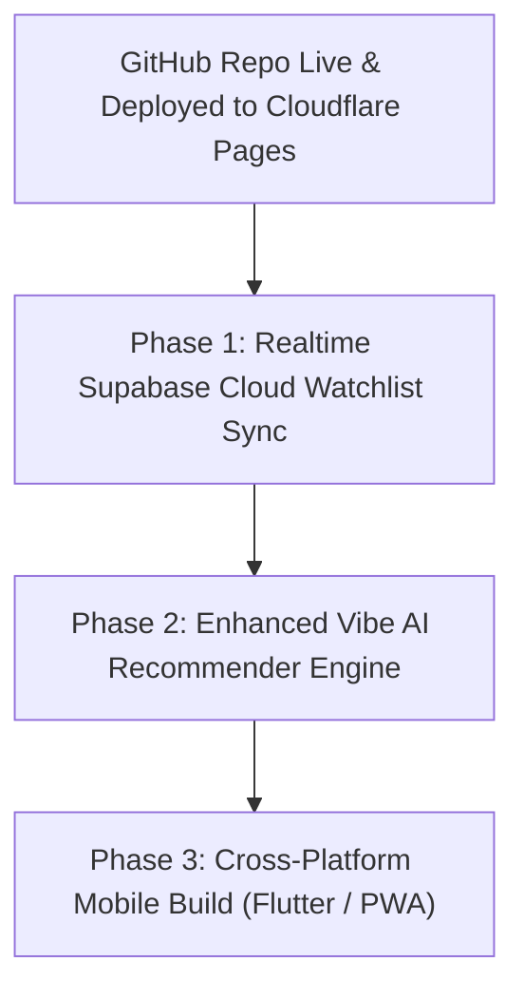

# 🎬 WatchVibe — Project Handoff & Session Continuity Guide

> [!IMPORTANT]
> **MANDATORY INSTRUCTION FOR ALL AGENTS & SESSIONS:**
> At the start of **every new session or task**, read this file (`HANDOFF.md`) before taking any action. It contains the exact verified codebase status, architecture decisions, deployment pipelines, credentials setup, and active roadmap.

---

## 📌 1. Project Overview & Live Access

| Attribute | Value / Link | Notes |
| :--- | :--- | :--- |
| **Project Name** | **WatchVibe** | Cinephile movie discovery & vibe matching SPA / PWA |
| **Live Production Web App** | [https://watchvibe-b92.pages.dev/](https://watchvibe-b92.pages.dev/) | Deployed on Cloudflare Pages Edge CDN |
| **Official GitHub Repository** | [https://github.com/DebarshiDas007/watchvibe](https://github.com/DebarshiDas007/watchvibe) | Public GitHub repo, branch `main` |
| **Local Dev Server** | `http://localhost:8080/` | Multi-threaded python local server |
| **Project Root Path** | `D:\watchvibe\` | Working directory |
| **Production Build Directory** | `D:\watchvibe\web_live_build\` | Clean production SPA bundle |
| **Cloudflare Deploy Script** | [deploy.py](file:///C:/Users/USER/.gemini/antigravity/scratch/watchvibe/deploy.py) | Automated headless Cloudflare CLI deploy |

---

## ⚡ 2. Current Verified Status (What is Complete & Working)

### A. GitHub Integration (Complete)
- **Repository**: [https://github.com/DebarshiDas007/watchvibe](https://github.com/DebarshiDas007/watchvibe)
- **Branch**: `main` (clean, fully synchronized).
- **Credentials & Git Tools**:
  - Portable Git 2.44.0 at `C:\Users\USER\.gemini\antigravity\scratch\tools\git\cmd\git.exe` in User `PATH`.
  - GitHub CLI 2.45.0 at `C:\Users\USER\.gemini\antigravity\scratch\tools\gh\bin\gh.exe` in User `PATH`.
  - Global git credential storage configured at `C:\Users\USER\.git-credentials` for headless `git push`/`git pull`.
- **Security**: [.gitignore](file:///C:/Users/USER/.gemini/antigravity/scratch/watchvibe/.gitignore) strictly prevents `.env`, tokens, zip archives, and caches from being committed.

### B. Authentication System (Mimcire 1:1 Replication)
- **Visual Design**: Replicated from [https://mimicore.app/account/](https://mimicore.app/account/) (`max-w-[500px]`, `border-radius: 22px`, dark glass finish).
- **3-Button Stack**:
  1. `Continue with Google` (Crisp white pill, official Google 4-color SVG).
  2. `Continue with Discord` (Blurple `#5865F2` pill, official Discord SVG).
  3. `Continue with email` (Dark translucent glass pill, mail icon).
- **Inline Drawer Interaction**:
  - Clicking `Continue with email` smoothly opens an inline drawer without page redirects.
  - Email input with placeholder `you@example.com`.
  - 1-Click domain pills: `+ @gmail.com`, `+ @outlook.com`, `+ @yahoo.com`, `+ @icloud.com`.
  - Mode toggle: swaps smoothly between magic link (`Email me a sign-in link`) and password (`Sign in with password`).
- **Zero Typing for Full Name**: Full human name is automatically synthesized from the email address handle (e.g., `alex.turner@gmail.com` -> `Alex Turner`).
- **Privacy & Multi-User Isolation (VERIFIED)**:
  - Multi-user leakage bug eliminated: guest and new visitors see clean `Sign in or create an account` and `Continue with Google`. Zero pre-filled emails from other users.
- **Immediate Sign Out (VERIFIED)**:
  - Storage keys are purged before memory state reset; UI updates immediately and the modal dismisses without requiring a browser page refresh.

### C. Cloudflare CLI Deployment Automation
- **Autonomous Headless Deployment**: Configured via `python deploy.py` (`wrangler.cmd pages deploy`).
- **No Manual Approval Needed**: Deploys run headlessly without manual user intervention.
- **Credentials Configured**:
  - Cloudflare API Token in [D:\watchvibe\.env](file:///C:/Users/USER/.gemini/antigravity/scratch/watchvibe/.env) and registered into User environment variables.
  - Portable Node.js 20 LTS at `C:\Users\USER\.gemini\antigravity\scratch\tools\nodejs\`.
  - Cloudflare `wrangler` CLI `v4.86.0`.

---

## 🛠️ 3. Operational Command Cheatsheet

### 1. Deploy Live to Cloudflare Pages (Auto-Approved)
```powershell
python D:\watchvibe\deploy.py
```

### 2. Push Changes to GitHub
```powershell
git add .
git commit -m "feat: description of changes"
git push
```

### 3. Run Local Dev Server
```powershell
# Dev server runs on port 8080:
http://localhost:8080/
```

---

## 🗺️ 4. Immediate Next Steps & Roadmap



1. **Phase 1 — Realtime Supabase Cloud Sync**:
   - Currently, user profiles and watchlists are stored in `localStorage` with offline service worker caching (`sw.js`).
   - If user supplies real Supabase project credentials (`SUPABASE_URL` and `SUPABASE_ANON_KEY`), connect client to cloud database for cross-device sync.
2. **Phase 2 — Enhanced Vibe Matching**:
   - Add mood filters and dynamic movie trailer integrations.
3. **Phase 3 — Native Mobile & PWA**:
   - PWA service worker and manifest are already bundled in `web_live_build/`.
   - Flutter codebase in `lib/` ready for native mobile builds.

---

## 🔒 5. Access Control & Security Policies
- **Never commit `.env` to git.**
- Cloudflare token is stored locally in `D:\watchvibe\.env`.
- Superadmin command studio is restricted strictly to `dasdebarshi1234@gmail.com`.
